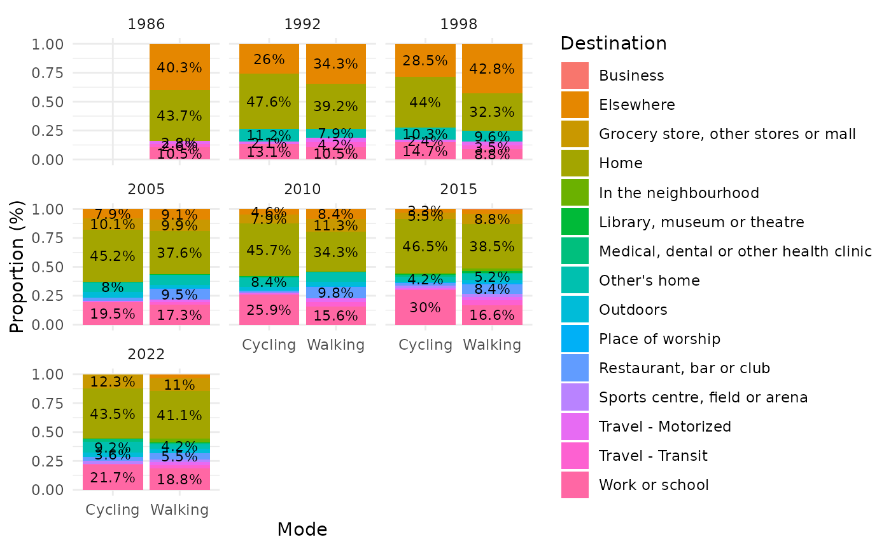
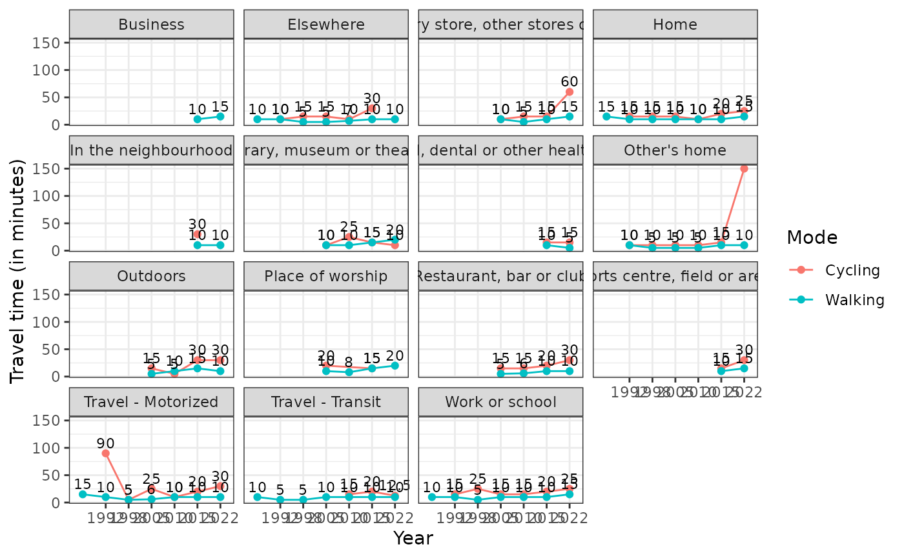
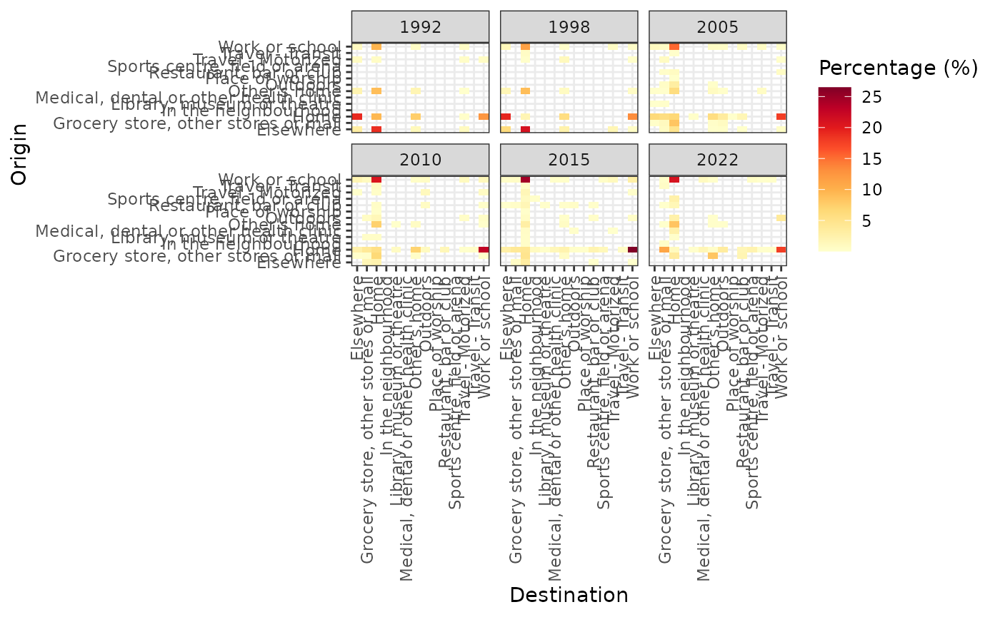

# ActiveCA-Applications

This vignette introduces some possible applications of ActiveCA
datasets.

To start the demonstration, it is first necessary to install the
package. The code chunk below demonstrates how to install the ActiveCA
package in R:

``` r

if(!require("ActiveCA", character.only = TRUE)) {
      remotes::install_github("dias-bruno/ActiveCA")
}
#> Loading required package: ActiveCA
```

After installing the {ActiveCA} R package, you can load it using the
following code:

``` r

library(ActiveCA)
```

The documentation of the package can be accessed by running
[`?ActiveCA`](https://dias-bruno.github.io/ActiveCA/reference/ActiveCA-package.md)
in `R`. The documentation includes a description of the package,
information about the authors, contributors, and maintainers, and an
overview of all pre-processed data sets included in the package.

The TUS surveys apply a probability sampling methodology, in which each
episode or person selected in the sample represents several other
episodes or persons not in the sample. The number of episodes and
persons represented by a episode or person is determined by the weight
or weighting factor. Because of this, estimates of the number of
episodes or persons need to be calculated applying the corresponding
weighting factors.

For instance, to calculate the percentage of respondents from the 2015
TUS GSS survey with active travel episodes, it is necessary to account
for the person’s weight. In 2015, the weight variable is represented by
`WGHT_PER.` The code below demonstrates how to obtain the percentage of
people with active travel episodes by age group. It uses the `dplyr`
package to manipulate the data.

The process begins by creating a dataset that sums the population by age
group. Then, it joins the 2015 episodes with the 2015 Main File. Note
that in both operations, the code sums the person weight variable
(`WGHT_PER`) to obtain the correct population values. After this, a new
dataset, `Active_percentage`, is created by merging both previous
datasets. The percentage of active travel episodes by age group is
calculated by dividing the total population by the population with
active trip episodes, then multiplying by 100 and rounding with 2
decimal places.

    #> 
    #> Attaching package: 'dplyr'
    #> The following objects are masked from 'package:stats':
    #> 
    #>     filter, lag
    #> The following objects are masked from 'package:base':
    #> 
    #>     intersect, setdiff, setequal, union
    #> # A tibble: 7 × 4
    #>   AGEGR10           Total_population Active_population Percentage
    #>   <ord>                        <dbl>             <dbl>      <dbl>
    #> 1 15 to 24 years            4511131.          2083224.       46.2
    #> 2 25 to 34 years            4956386.          1982204.       40.0
    #> 3 35 to 44 years            4734506.          1099412.       23.2
    #> 4 45 to 54 years            5136125.          1031387.       20.1
    #> 5 55 to 64 years            4831306.           931296.       19.3
    #> 6 65 to 74 years            3283969.           645176.       19.6
    #> 7 75 years and over         2312976.           449919.       19.4

The result shows that the age group with the highest share of active
trips is those between 15 and 20 years old, with almost 37%, followed by
those between 25 and 34 years old with around 33%. There is a
significant drop in percentage for the following groups, with the
percentage falling to between 15% and 18% for the remaining age groups.

Now, let’s load some other data sets to carry out more analysis:

``` r

data("gss_episodes")
data("gss_main_2022")
data("gss_main_2015")
data("gss_main_2010")
data("gss_main_2005")
data("gss_main_1998")
data("gss_main_1992")
data("gss_main_1986")
```

The next chunk shows how to obtain the standard deviation, and minimum,
maximum, median, and mean values for walking and cycling, by year:

``` r

# Calculate min, mean, and max statistic (duration)
stats_data <- gss_episodes |>
  group_by(YEAR, MODE) |>
  dplyr::summarise(
    min = min(DURATION),
    mean = sum(DURATION * WGHT_EPI)/sum(WGHT_EPI),
    median =  Hmisc::wtd.quantile(DURATION, weights = WGHT_EPI, probs = 0.5),
    max = max(DURATION),
    std = sd(DURATION),
    .groups = "drop"
  )

stats_data
#> # A tibble: 13 × 7
#>     YEAR MODE      min  mean median   max   std
#>    <dbl> <chr>   <int> <dbl>  <dbl> <int> <dbl>
#>  1  1986 Walking     1  21.5     10   660  31.4
#>  2  1992 Cycling     5  24.2     15   240  32.7
#>  3  1992 Walking     1  16.2     10   300  18.0
#>  4  1998 Cycling     2  21.2     15    90  17.5
#>  5  1998 Walking     1  11.2      5   285  13.4
#>  6  2005 Cycling     1  19.3     15   180  17.8
#>  7  2005 Walking     0  12.0     10   515  15.5
#>  8  2010 Cycling     1  18.9     10   270  26.2
#>  9  2010 Walking     0  12.6     10   480  16.6
#> 10  2015 Cycling     5  26.4     20   175  25.0
#> 11  2015 Walking     5  17.2     10   900  24.9
#> 12  2022 Cycling     5  39.2     30   150  20.2
#> 13  2022 Walking     5  18.3     15   480  23.0
```

The following chunk shows the share of each destination in the total
number of trips, by year and mode of transport:

``` r

library(ggplot2)

destination_percentual <- gss_episodes %>%
  group_by(MODE, dest_label, YEAR) %>%
  dplyr::summarise(n = sum(WGHT_EPI), .groups = "drop") %>%
  group_by(MODE, YEAR) %>%
  mutate(percentage = n / sum(n) * 100) %>%
  ungroup() %>%
  group_by(MODE, YEAR) %>%
  mutate(rank = rank(-percentage, ties.method = "first")) %>%
  mutate(label = ifelse(rank <= 5, paste0(round(percentage, 1), "%"), NA)) %>%
  ggplot(aes(x = MODE, fill = dest_label, y = percentage)) +
  geom_bar(stat = "identity", position = "fill") +
  labs(y = "Proportion (%)",
       x = "Mode",
       fill = "Destination") +
  theme_minimal() + 
  facet_wrap(~ as.factor(YEAR)) +
  geom_text(aes(label = label), 
            position = position_fill(vjust = 0.5), size = 3)

destination_percentual
```


Displaying the evolution of the average duration by mode of transport
for each destination:

``` r

library(tidyr)

destination_medians <- gss_episodes %>%
  uncount(weights = round(WGHT_EPI)) %>%
  group_by(YEAR, dest_label, MODE) %>%
  summarise(median_duration = median(DURATION), .groups = "drop") %>%
  ggplot(aes(x = as.factor(YEAR), y = median_duration, color = MODE, group = interaction(dest_label, MODE))) +
  geom_line() +  
  geom_point() + 
  geom_text(aes(label = round(median_duration, 1)), 
            vjust = -0.5,  
            size = 3,      
            color = "black") + 
  theme_bw() +   
  facet_wrap(~dest_label) + 
  scale_x_discrete(
    breaks = c(1992, 1998, 2005, 2010, 2015, 2022)) +
  labs(
    color = "Mode",                      
    x = "Year",                          
    y = "Travel time (in minutes)")

destination_medians
```



In conclusion, the next part presents how to obtain heat maps to show
the percentage of each combination of origin and destination for Cycling
mode:

``` r

cycling_hm_fig <- gss_episodes %>%
  filter(MODE == 'Cycling') %>%
  group_by(orig_label, dest_label, YEAR) %>%
  dplyr::summarise(n = sum(WGHT_EPI),
  .groups = "drop") %>%
  group_by(YEAR) %>%
  mutate(percentage = n / sum(n) * 100) %>%
  ungroup() %>%
  ggplot(aes(x = dest_label,
    y = orig_label)) +
    geom_tile(aes(fill = percentage)) +
    labs(x = "Destination",
    y = "Origin",
    fill = "Percentage (%)") + 
    #geom_text(aes(label = round(percentage)), color = "black", size = 3) + 
    theme_bw() + 
    theme(axis.text.x = element_text(angle = 90, vjust = 0.5, hjust=1)) + 
    scale_fill_gradientn(colors = RColorBrewer::brewer.pal(9, "YlOrRd")) +
    facet_wrap(~YEAR)

cycling_hm_fig
```


